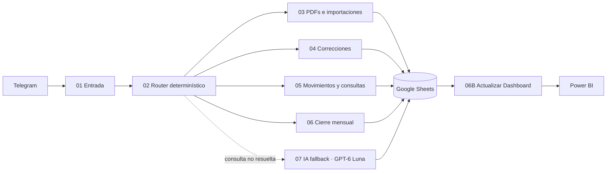

# Sistema Familiar — Finanzas Familiares con IA

**Trabajo Final Integrador — Diplomatura en IA Aplicada a Entornos Digitales de Gestión, FCE-UBA · Cohorte 2026**

Sistema familiar de gestión financiera que centraliza movimientos provenientes de Telegram, bancos, tarjetas, billeteras e inversiones. La solución combina **n8n + Google Sheets + Power BI** y utiliza **GPT-6 Luna únicamente como fallback de razonamiento**, manteniendo la lógica financiera crítica en reglas determinísticas.

> Versión académica de entrega: **v1.1** · Octubre 2026  
> Los archivos públicos fueron sanitizados: no contienen credenciales, IDs personales ni datos bancarios reales.

## Problema

La información financiera familiar estaba distribuida entre efectivo, cuentas bancarias, billeteras virtuales, tarjetas, inversiones y resúmenes PDF. Eso hacía costoso responder preguntas simples —cuánto se gastó, en qué categoría, qué falta conciliar o cómo cerró un mes— y aumentaba el riesgo de duplicar movimientos.

## Objetivo

Construir una capa simple de gestión que permita:

- registrar ingresos y gastos desde Telegram;
- importar y normalizar PDFs bancarios y de tarjetas;
- evitar duplicados y conservar trazabilidad;
- corregir movimientos sin editar manualmente el ledger;
- consultar gastos, categorías y períodos;
- realizar un cierre mensual conversacional y conciliado;
- tratar movimientos en ARS y USD;
- visualizar resultados en Google Sheets y Power BI;
- usar IA sólo cuando una consulta no puede resolverse de forma determinística.

El sistema **no pretende ser un ERP ni reemplazar una solución contable o impositiva**.

## Arquitectura



## Componentes de la versión presentada

| Componente | Responsabilidad | Versión |
|---|---|---:|
| 01 | Entrada y menú de Telegram | v39 |
| 02 | Router determinístico + derivación a IA | v43 |
| 03 | PDFs e importaciones | v96 |
| 04 | Correcciones | v31 |
| 05 | Movimientos y consultas | v38 |
| 06 | Cierre mensual conversacional | v6.9 |
| 06B | Actualización de Dashboard | v6.9 |
| 07 | IA fallback de sólo lectura | v7 |
| Power BI | Analítica y visualización | v1.8 |

## Diseño: determinismo primero, IA después

La decisión principal del proyecto fue **no delegar a un LLM los cálculos financieros ni la escritura directa de datos**.

El router intenta resolver primero cada acción mediante reglas explícitas. GPT-6 Luna se invoca únicamente ante consultas de razonamiento que no encajan en rutas determinísticas. El módulo 07:

- trabaja en **sólo lectura**;
- recibe contexto financiero ya preparado y acotado;
- no registra, corrige, borra ni cierra movimientos;
- usa salida estructurada;
- diferencia `resultado_operativo`, `resultado_financiero` y `resultado_total`;
- evita doble conteo de gastos USD;
- devuelve una aclaración si faltan datos;
- deriva las acciones de escritura nuevamente a los flujos determinísticos.

Esta separación reduce errores, costo y superficie de riesgo.

## Flujo de ejemplo

1. El usuario escribe o selecciona una acción en Telegram.
2. `01` normaliza la interacción y delega a `02`.
3. `02` determina la intención.
4. Si existe una ruta determinística, deriva a `03`, `04`, `05` o `06`.
5. Si la consulta requiere razonamiento no cubierto por reglas, deriva a `07`.
6. Los movimientos y cierres quedan consolidados en Google Sheets.
7. `06B` materializa el Dashboard y Power BI consume tablas normalizadas.

## Tratamiento de USD

La versión final conserva:

- moneda y monto original;
- cotización y fuente cuando están disponibles;
- equivalente ARS materializado cuando existe cotización válida;
- prevención de doble conteo en transferencias propias y pagos de tarjeta.

No se inventa una cotización faltante.

## Validación funcional

Entre las pruebas realizadas se incluyeron:

- registro real desde Telegram y verificación en `Movimientos`;
- importación y control de duplicados;
- conciliación de períodos;
- cierre mensual con actualización de Dashboard;
- validación de gastos USD y equivalencia ARS;
- comparación entre Google Sheets y Power BI;
- consultas complejas enviadas al fallback de IA.

La documentación detallada está en [`docs/TESTS_AND_RESULTS.md`](docs/TESTS_AND_RESULTS.md).

## Estructura del repositorio

```text
.
├── README.md
├── SECURITY.md
├── docs/
│   ├── ARCHITECTURE.md
│   ├── METHODOLOGY.md
│   ├── AI_FALLBACK.md
│   ├── TESTS_AND_RESULTS.md
│   ├── AIBPS.md
│   ├── CHANGELOG.md
│   └── BASELINE_AND_VERSIONS.md
├── workflows/
│   ├── 01_entrada_telegram_v39.json
│   ├── 02_router_deterministico_v43_ia_fallback.json
│   ├── 03_pdfs_importaciones_v96.json
│   ├── 04_correcciones_v31.json
│   ├── 05_movimientos_consultas_v38.json
│   ├── 06_cierre_mensual_SPEC.md
│   ├── 06B_actualizar_dashboard_v6_9.json
│   └── 07_ia_fallback_v7_gpt6_luna.json
└── examples/
    ├── sample_movements.csv
    └── sample_queries.md
```

## Instalación / reproducción

Requisitos:

- una instancia de n8n;
- un bot de Telegram;
- un Google Sheet con las hojas requeridas;
- credenciales de Google Sheets configuradas en n8n;
- una API key de OpenAI para el módulo 07;
- Power BI Desktop sólo si se desea reproducir la capa de visualización.

Pasos generales:

1. Importar los workflows sanitizados.
2. Reconfigurar credenciales de Telegram y Google Sheets.
3. Reemplazar `YOUR_GOOGLE_SHEET_ID`.
4. Relinkear los subworkflows marcados como `WORKFLOW_ID_RELINK_REQUIRED`.
5. Configurar el módulo 07 con una credencial HTTP Header Auth para OpenAI.
6. Probar primero las rutas determinísticas.
7. Habilitar el fallback de IA recién después de validar las operaciones básicas.

> El export contemporáneo de `06 — Cierre mensual v6.9` no estaba archivado al momento de preparar el repositorio público. Se incluye su especificación funcional para conservar trazabilidad sin afirmar una reproducibilidad que el archivo disponible no permite.

## Seguridad y privacidad

Los exports incluidos fueron sanitizados deliberadamente. El repositorio no publica tokens, credenciales, IDs de Telegram, CUIT/CVU, identificadores bancarios ni datos familiares reales. Ver [`SECURITY.md`](SECURITY.md).

## Contexto académico

El proyecto fue desarrollado como Trabajo Final Integrador de la **Diplomatura en IA Aplicada a Entornos Digitales de Gestión — FCE-UBA, Cohorte 2026**.

El foco no está puesto en la complejidad técnica, sino en el criterio de diseño: automatizar lo repetible, reservar la IA para donde aporta valor y mantener los cálculos y las acciones sensibles bajo reglas verificables y control humano.
