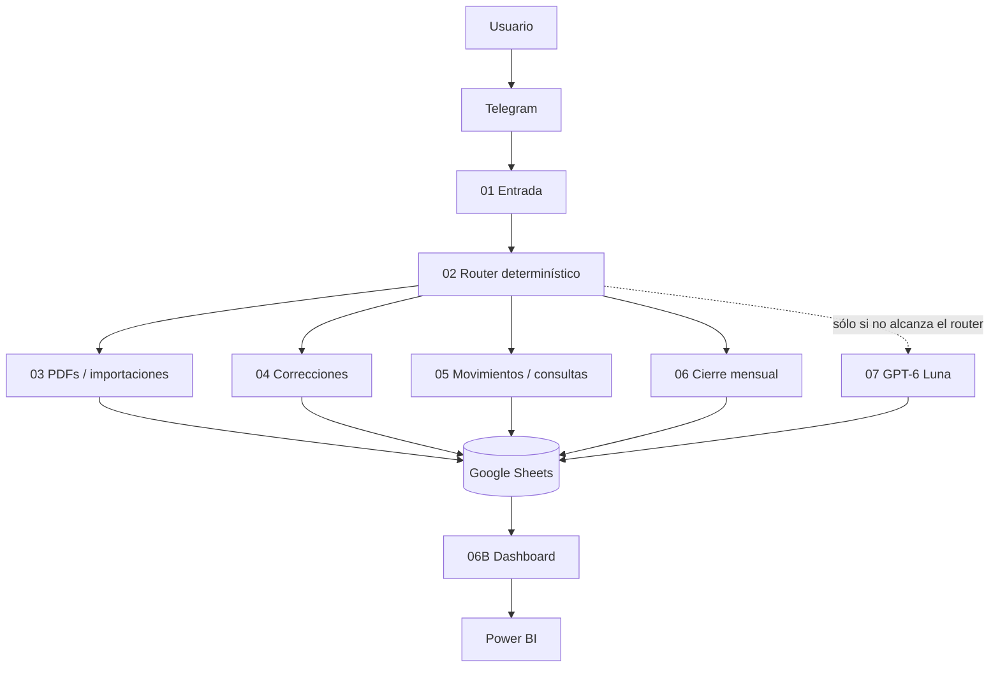

# Arquitectura

## Principio general

La arquitectura separa interfaz, enrutamiento, lógica operativa, datos, cierre, analítica e IA.

## Fuente de verdad

Google Sheets funciona como fuente operativa. La hoja `Movimientos` concentra el ledger normalizado; otras hojas soportan cuentas, tarjetas, inversiones, importaciones, reglas, auditoría, conciliación y cierres.

Power BI consume información ya normalizada y no reemplaza la fuente operativa.

## Separación de responsabilidades

- **01:** interfaz y estado guiado de Telegram.
- **02:** detección de intención, reglas y routing.
- **03:** parsers y normalización documental.
- **04:** correcciones trazables.
- **05:** altas manuales y consultas determinísticas.
- **06:** conciliación y cierre mensual.
- **06B:** materialización del Dashboard.
- **07:** razonamiento no determinístico, sólo lectura.
- **Power BI:** visualización y análisis.

## Decisiones de alcance

Se retiró el módulo de vencimientos antes de la entrega porque agregaba complejidad operativa y de mantenimiento desproporcionada respecto del objetivo principal. La versión presentada prioriza registro, conciliación, cierre, consulta y analítica.
